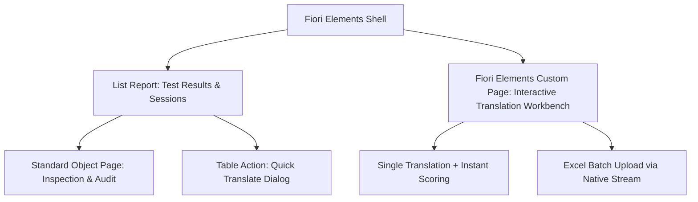

# 100% Strict SAP CAPM & Fiori Elements Architectural Blueprint

## 1. Executive Summary

This blueprint outlines the complete transformation of the **PLM Translator** project into a **100% strict SAP Cloud Application Programming Model (CAPM)** and **SAP Fiori Elements (OData V4)** enterprise application.

### Current State vs. 100% Strict CAPM State

| Dimension | Current Implementation | 100% Strict CAPM Target |
| :--- | :--- | :--- |
| **Data Model (`db/`)** | Single flat entity with manual fields | Normalized CDS model with `cuid`, `managed`, `sap.common.CodeList`, enum types, and session compositions |
| **Service Layer (`srv/`)** | Hybrid CAP + custom Express routes (`srv/server.js` with `multer`) | Pure CAP service with native OData V4 media streams (`@Core.MediaType`), eliminating custom Express bypasses |
| **Security & RBAC** | Basic `@requires: 'authenticated-user'` | Declarative entity-level `@restrict` with granular scopes (`TranslatorUser`, `TranslatorAdmin`) |
| **UI Layer (`app/`)** | Freestyle SAPUI5 with XMLViews, manual controllers, and DOM logic | SAP Fiori Elements OData V4 (List Report & Object Page + Custom Actions/Sections) |
| **UI Configuration** | Hardcoded XML tables, forms, and custom CSS | 100% metadata-driven using standard CDS `@UI` and `@Common` annotations |
| **Excel Handling** | External Express endpoints (`/api/upload-and-translate`) | Native CAP OData V4 file stream or bound actions (`LargeBinary`) |

---

## 2. Layer 1: Schema Architecture (`db/schema.cds`)

In pure CAP, the database schema leverages standard reuse aspects, normalized CodeLists for language lookups, and structured types:

```cds
namespace plm.translator;

using { cuid, managed, sap.common.CodeList } from '@sap/cds/common';

/**
 * Outcome enum type with strict domain values
 */
type OutcomeType : String enum {
    Success = 'Success';
    Failure = 'Failure';
    Partial = 'Partial';
};

/**
 * Supported Languages as standard SAP CodeList
 * Provides automated Fiori Elements Value Help dropdowns
 */
entity Languages : CodeList {
    key code : String(10); // e.g., 'en', 'de', 'ta', 'hi'
}

/**
 * Header entity for Mass Translation Batch Sessions
 */
entity TranslationSessions : cuid, managed {
    sessionName     : String(100) @title: 'Session Name';
    totalRows       : Integer     @title: 'Total Rows';
    successful      : Integer     @title: 'Successful';
    failed          : Integer     @title: 'Failed';
    successRate     : Double      @title: 'Success Rate (%)';
    testedBy        : String(100) @title: 'Tested By';
    
    // Header-Item Composition
    results         : Composition of many TestResults on results.session = $self;
}

/**
 * TestResults entity - individual translation evaluation records
 */
entity TestResults : cuid, managed {
    session         : Association to TranslationSessions;
    outcome         : OutcomeType @mandatory @title: 'Outcome';
    accuracy        : Double      @assert.range: [0, 100] @title: 'Accuracy (%)';
    observation     : String(5000) @title: 'Observations';
    testedBy        : String(100)  @mandatory @title: 'Tested By';
    textToTranslate : LargeString  @mandatory @title: 'Source Text';
    translatedText  : LargeString  @title: 'Translated Text';
    sourceLanguage  : Association to Languages @title: 'Source Language';
    targetLanguage  : Association to Languages @mandatory @title: 'Target Language';
    
    // Virtual or computed criticality for Fiori status colors (1=Red, 2=Orange, 3=Green)
    virtual criticality : Integer;
}

/**
 * Native CAP Media Entity for Excel Batch Processing
 * Replaces multer and custom Express routes
 */
entity ExcelUploads : cuid, managed {
    @Core.MediaType: mediaType
    content   : LargeBinary;
    @Core.IsMediaType: true
    mediaType : String;
    fileName  : String;
    testedBy  : String;
    status    : String;
}
```

---

## 3. Layer 2: Service Definition & RBAC (`srv/translator-service.cds`)

Declarative role-based restrictions tied to the scopes defined in `xs-security.json`:

```cds
using { plm.translator as db } from '../db/schema';

@path: '/service/translator'
service TranslatorService @(requires: 'authenticated-user') {

    // ─── TestResults Entity with Granular Authorization ───
    @odata.draft.enabled
    entity TestResults as projection on db.TestResults actions {
        // Bound action to re-test translation
        action retest() returns TestResults;
    };

    annotate TestResults with @(restrict: [
        { grant: ['READ', 'translate'], to: 'TranslatorUser' },
        { grant: '*', to: 'TranslatorAdmin' }
    ]);

    // ─── Translation Sessions Header ───
    @readonly
    entity TranslationSessions as projection on db.TranslationSessions;

    // ─── CodeList for Value Helps ───
    @readonly
    entity Languages as projection on db.Languages;

    // ─── Native Media Entity for Excel Batch Upload ───
    entity ExcelUploads as projection on db.ExcelUploads;

    // ─── Unbound Translation Actions ───
    action translate(
        text           : LargeString,
        targetLanguage : String
    ) returns {
        success        : Boolean;
        translatedText : LargeString;
        sourceLanguage : String;
        targetLanguage : String;
        error          : String;
    };

    // ─── Download Blank Template ───
    function downloadTemplate() returns LargeBinary;
}
```

---

## 4. Layer 3: Fiori Elements Annotations (`srv/annotations.cds`)

These annotations instruct the SAP Fiori Elements runtime how to render the entire UI automatically:

```cds
using { TranslatorService as srv } from './translator-service';

// ─── Header Info & Title ───
annotate srv.TestResults with @(
    UI.HeaderInfo: {
        TypeName: 'Translation Test Result',
        TypeNamePlural: 'Translation Test Results',
        Title: { Value: textToTranslate },
        Description: { Value: translatedText }
    },

    // ─── Filter Bar (SmartFilterBar) ───
    UI.SelectionFields: [
        outcome,
        targetLanguage_code,
        testedBy,
        createdAt
    ],

    // ─── Table Columns (SmartTable) ───
    UI.LineItem: [
        {
            $Type: 'UI.DataField',
            Value: outcome,
            Criticality: criticality,
            CriticalityRepresentation: #WithIcon
        },
        {
            $Type: 'UI.DataField',
            Value: accuracy
        },
        {
            $Type: 'UI.DataField',
            Value: targetLanguage_code
        },
        {
            $Type: 'UI.DataField',
            Value: textToTranslate
        },
        {
            $Type: 'UI.DataField',
            Value: translatedText
        },
        {
            $Type: 'UI.DataField',
            Value: testedBy
        },
        {
            $Type: 'UI.DataField',
            Value: createdAt
        },
        {
            $Type: 'UI.DataFieldForAction',
            Action: 'TranslatorService.translate',
            Label: 'Quick Translate',
            InvocationGrouping: #Isolated
        }
    ],

    // ─── Object Page Facets ───
    UI.Facets: [
        {
            $Type: 'UI.ReferenceFacet',
            ID: 'GeneralInfoFacet',
            Label: 'General Information',
            Target: '@UI.FieldGroup#GeneralInfo'
        },
        {
            $Type: 'UI.ReferenceFacet',
            ID: 'TranslationFacet',
            Label: 'Translation Details',
            Target: '@UI.FieldGroup#Translation'
        },
        {
            $Type: 'UI.ReferenceFacet',
            ID: 'EvaluationFacet',
            Label: 'Quality & Evaluation',
            Target: '@UI.FieldGroup#Evaluation'
        }
    ],

    UI.FieldGroup #GeneralInfo: {
        Data: [
            { Value: session_ID, Label: 'Session' },
            { Value: testedBy, Label: 'Evaluator' },
            { Value: createdAt, Label: 'Created On' },
            { Value: modifiedAt, Label: 'Modified On' }
        ]
    },

    UI.FieldGroup #Translation: {
        Data: [
            { Value: sourceLanguage_code, Label: 'Source Language' },
            { Value: textToTranslate, Label: 'Source Text' },
            { Value: targetLanguage_code, Label: 'Target Language' },
            { Value: translatedText, Label: 'Translated Output' }
        ]
    },

    UI.FieldGroup #Evaluation: {
        Data: [
            { Value: outcome, Label: 'Outcome', Criticality: criticality },
            { Value: accuracy, Label: 'Accuracy Rating (%)' },
            { Value: observation, Label: 'Notes & Observations' }
        ]
    }
);

// ─── Value Help for Target Languages ───
annotate srv.TestResults with {
    targetLanguage @(
        Common.ValueList: {
            CollectionPath: 'Languages',
            Label: 'Target Languages',
            Parameters: [
                {
                    $Type: 'Common.ValueListParameterInOut',
                    LocalDataProperty: targetLanguage_code,
                    ValueListProperty: 'code'
                },
                {
                    $Type: 'Common.ValueListParameterDisplayOnly',
                    ValueListProperty: 'name'
                }
            ]
        }
    );
};
```

---

## 5. Layer 4: UI Architecture (SAP Fiori Elements Floorplan)

### Manifest Structure (`app/translator/webapp/manifest.json`)

The application is configured with standard Fiori Elements components:

```json
{
  "_version": "1.65.0",
  "sap.app": {
    "id": "plm.translator.fe",
    "type": "application",
    "title": "PLM Translation Workbench",
    "dataSources": {
      "mainService": {
        "uri": "service/translator/",
        "type": "OData",
        "settings": {
          "annotations": ["annotation"],
          "odataVersion": "4.0"
        }
      },
      "annotation": {
        "type": "ODataAnnotation",
        "uri": "service/translator/$metadata"
      }
    }
  },
  "sap.ui5": {
    "routing": {
      "routes": [
        {
          "pattern": ":?query:",
          "name": "TestResultsList",
          "target": "TestResultsList"
        },
        {
          "pattern": "TestResults({key}):?query:",
          "name": "TestResultsObjectPage",
          "target": "TestResultsObjectPage"
        }
      ],
      "targets": {
        "TestResultsList": {
          "type": "Component",
          "id": "TestResultsList",
          "name": "sap.fe.templates.ListReport",
          "options": {
            "settings": {
              "contextPath": "/TestResults"
            }
          }
        },
        "TestResultsObjectPage": {
          "type": "Component",
          "id": "TestResultsObjectPage",
          "name": "sap.fe.templates.ObjectPage",
          "options": {
            "settings": {
              "contextPath": "/TestResults"
            }
          }
        }
      }
    }
  }
}
```

### Interactive Translation Workbench Options

To support active translation workflows (Single Text Translate & Excel Mass Upload) in Fiori Elements:



---

## 6. Implementation Roadmap

1. **Step 1: Schema Modernization (`db/schema.cds`)**
   - Add `Languages` CodeList and pre-seed with ISO language codes (`db/data/plm.translator-Languages.csv`).
   - Add `OutcomeType` enum and criticality calculation.
   - Add `TranslationSessions` header and composition.

2. **Step 2: Service Definition & RBAC (`srv/translator-service.cds` & `srv/translator-service.js`)**
   - Add declarative `@restrict` security rules.
   - Implement `translate` action handler and native media handler for template/result streaming.
   - Remove custom Express route injections from `server.js`.

3. **Step 3: Fiori Elements Metadata Annotations (`srv/annotations.cds`)**
   - Complete `@UI.LineItem`, `@UI.SelectionFields`, `@UI.Facets`, `@UI.HeaderInfo`.
   - Configure Value Helps and Criticality mappings.

4. **Step 4: Fiori Elements UI Application (`app/translator`)**
   - Configure standard Fiori Elements List Report and Object Page.
   - Integrate custom actions/page for Translation Workbench.
   - Update `Component-preload` generation and dependencies.

5. **Step 5: Verification & Build**
   - Run local `cds watch` to verify Fiori preview.
   - Compile MTAR archive with `mbt build`.
   - Verify compatibility with SAP Build Work Zone.
